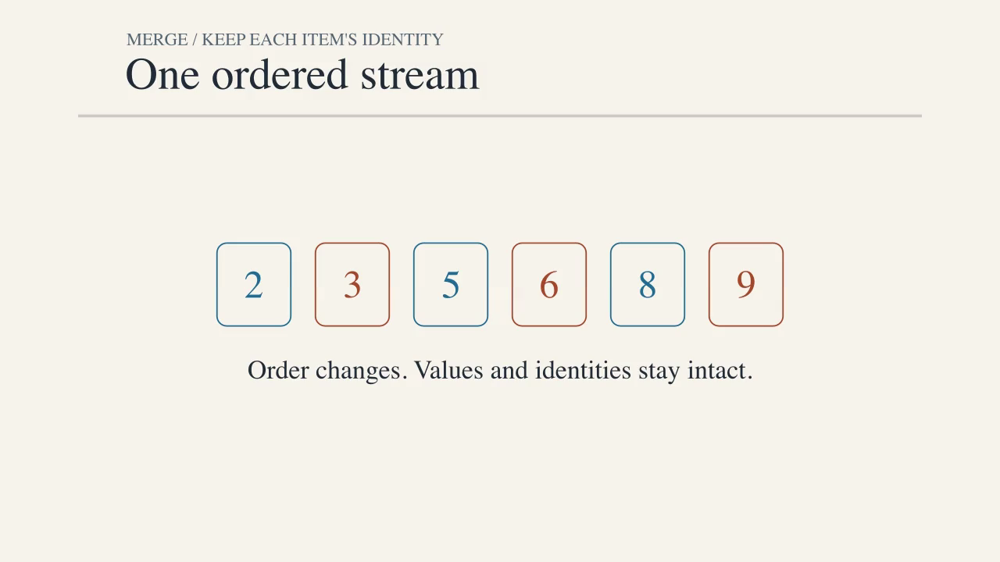
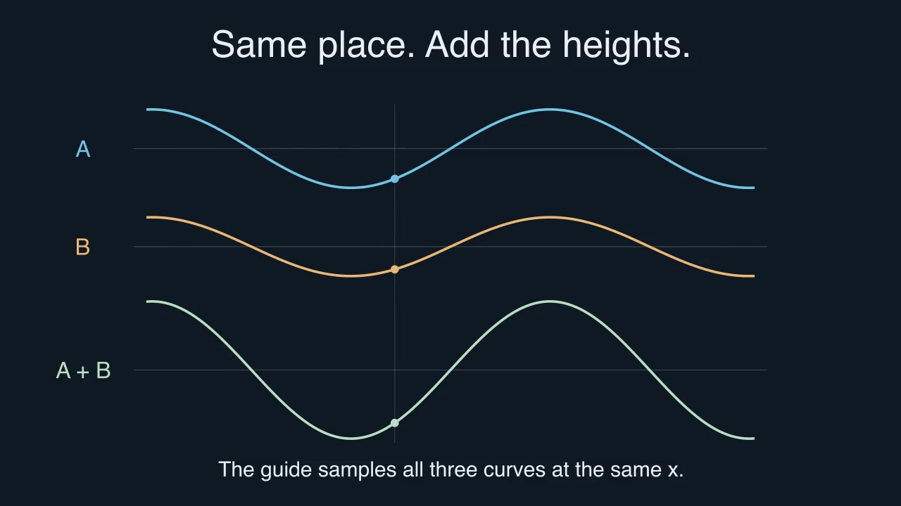
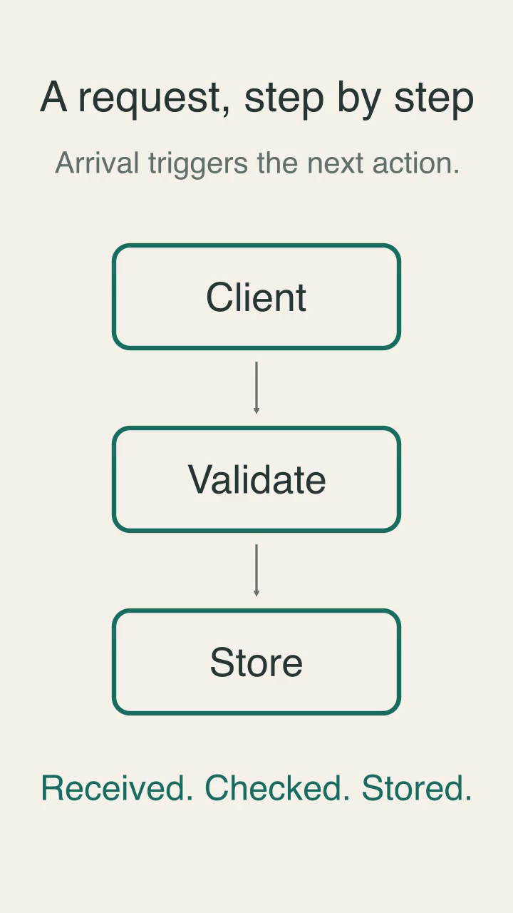
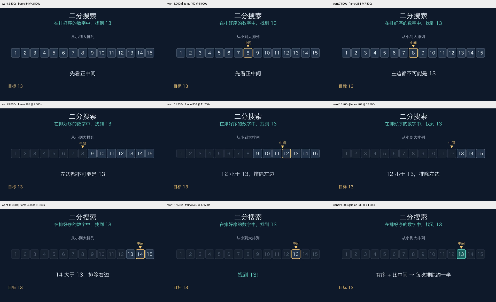
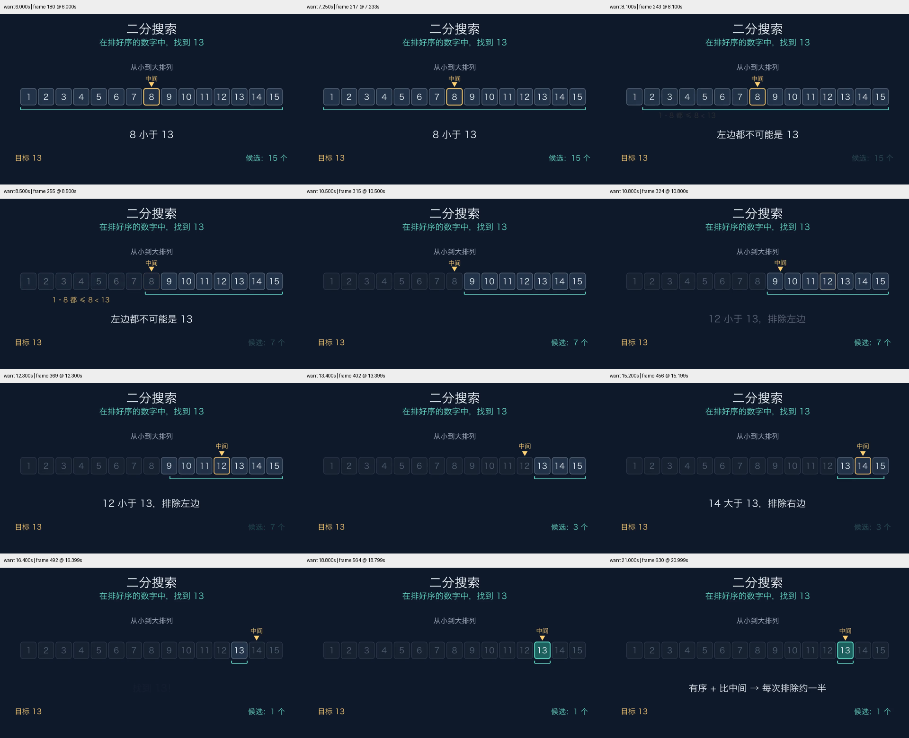

# 动画创作融合：验证记录

2026-10-29。对应[30 项目调研](../../research/animation-craft-2026-10-29.md)。
环境：macOS、Python 3.13.16、ManimCE 0.22.0、Cairo。素材均为本轮原创，未加入上游字体或媒体。
源码、Skill、锁文件与视频身份见 [conditions.json](conditions.json)。

## 自动检查

- `uv run python -m unittest discover -s tests -v`：11 项通过，包括原有快排/解码测试，新增稳定归并身份、波形叠加、竖屏相机构造、过渡邻域和 HTML 视频路径测试。
- `uv run python scripts/smoke.py --include-typst --output verification/craft-all`：20 个场景全部渲染并完整解码；`MathExample` 因未请求外部 TeX 而跳过。
- 新示例调整字体与竖屏构造后，使用 `verification/craft-revised` 再跑三项定向 smoke，全部通过。旧场景没有改动。
- Skill frontmatter/脚手架检查通过，`git diff --check` 通过。没有远程 CI 运行结论；本记录是本地验证。

## 成片与画面检查

| 场景 | 最终规格 | 检查重点与结果 |
|---|---|---|
| MergeStep | 1280×720 / 30 fps / 429 帧 / 约 14.297 秒 | 比较状态、两次转移邻域、后续选择、最终收拢；卡片身份保持，抽样未见关键遮挡或裁切 |
| WaveSuperposition | 1280×720 / 30 fps / 528 帧 / 17.600 秒 | 同 x 探针、相位变化、抵消与恢复；固定比例，A+B 的值来自输入的同一状态 |
| PacketJourney 横屏 | 1280×720 / 30 fps / 354 帧 / 约 11.797 秒 | 路线、传输中段、完成状态；目的节点在到达后强调 |
| PacketJourney 竖屏 | 720×1280 / 30 fps / 354 帧 / 约 11.797 秒 | 重新构图为竖排，标题/节点/箭头/结论可读，抽样无关键裁切 |

采样时间保存在 conditions.json；视频、原分辨率帧、拼图和检查页在本地 `verification/delivery-*` 与 `verification/delivery-review/`，不提交媒体缓存。以下是同一已检查成片的帧：







播放器功能实测：时间点按钮跳转到 3.6 秒，速度切换到 0.5×；最终归并、波形、竖屏三支片在浏览器 1× 播放到结束，媒体错误为空，浏览器报告 dropped frames 为 0。这验证本机的播放路径，**不等于逐帧观看或节奏审美验收**。视觉判断来自上述静帧与过渡采样；没有真实受众理解测试。

## 实际发现与修订

1. 归并首稿结尾的结果仍停在下方，留下较大的空源区。最终版在来源标签退场后把结果移到焦点区；首稿保留于 `verification/craft-draft`，最终版保留于 `verification/delivery-0`。
2. 竖屏首稿只改了像素分辨率；Cairo 保持场景宽度，画面中仍是很小的横向流程。复查相机源码后，在 Scene 构造前用 scoped `tempconfig` 设置匹配宽度，构图读取实际相机尺寸。新增测试验证 9:16、目标场景高度与全局配置不泄漏。首稿保留在 `verification/portrait`，最终版在 `verification/delivery-3`。
3. 检查页的路径测试发现 macOS 临时目录 `/var` 与 `/private/var` 的软链接差异。先解析真实路径再计算视频相对路径，测试通过。此问题来自实际测试，不是额外推测的安全框架。
4. 最终版明确字体家族：归并使用 serif，波形与流程使用 sans-serif；重新渲染并复查。不同系统解析的字体可能不同，不能以本机结果代替跨平台视觉检查。

## 独立新任务试用

任务与查看产出前记录的判据见 [criteria.json](criteria.json)。新代理使用请求配置 `gpt-6.1-terra / medium`，未继承父会话，只收到任务、Skill 路径、已有环境及隔离输出目录。它自行选择有序数组 1–15、目标 13 和构图。

盲测首轮最终产物为 **1280×720、30 fps、22.3 秒、669 帧**。可重渲染源码保存在 [binary_search-v1.py](binary_search-v1.py)，抽帧证据如下。源码使用本机 `Hiragino Sans GB`，字体不随仓库分发，因此这个评估快照不加入默认跨平台 smoke 扫描。



父代理独立计算参考路径：[binary-search-reference.json](binary-search-reference.json)。比较值为 8 → 12 → 14 → 13，候选数为 15 → 7 → 3 → 1，与首版源码及采样状态一致。关键中文可读，已采样帧未见关键裁切。代理自行发现并修改了草稿时长不足和文字重叠；草稿源码、视频与截图保留在本地 `verification/forward-trial/`，没有据此计算首次成功率。

父审查发现的不足：候选区间/数量缩小主要由变暗的数字行暗示，“为什么整个区域都能排除”偏重字幕。之后另行给出了有针对性的反馈，要求保留首版并增强有序关系和候选范围的可见性。该修订属于**有反馈的第二轮**，不合并为盲测首轮成绩。

第二轮交付 **1280×720、30 fps、663 帧、约 22.099 秒**。新增可收缩的候选区间、15 → 7 → 3 → 1 数量，以及被排除区域旁的 `1–8 都 ≤ 8 < 13`；字幕和数量切换改为先退后进。父代理复查源码及 12 个成片时间点，区间终态与独立参考计算一致，抽样未见关键遮挡。这次实际问题还反馈到创作配方中：排除操作可用区间/数量表达，重叠基线的无关字幕需检查交叉淡化中点。

第二轮源码：[binary_search-v2.py](binary_search-v2.py)。首轮、第二轮视频与草稿保留原目录；两版源文件和视频哈希记录于 conditions.json。

第二轮成片也通过浏览器 1× 播放至结束的功能检查，媒体错误为空、报告丢帧为 0；这与静帧审查分开记录，未据此声称完整的节奏审美验收。



## 复现

```bash
uv sync --python 3.13 --locked --extra typst
uv run python -m unittest discover -s tests -v
uv run python scripts/smoke.py --include-typst
uv run python -m manim render -qm examples/merge_step.py MergeStep
uv run python -m manim render -qm examples/wave_superposition.py WaveSuperposition
uv run python -m manim render -qm --resolution 720,1280 examples/packet_journey.py PacketJourney
```

需要中文试用的字体时，先选用实际安装且覆盖中文字形的字体再渲染。图片和 JSON 是这次产物的证据，不承诺跨平台字节一致。

本轮没有旧 Skill 对照组，也没有多任务独立样本、OpenGL 验证、真实受众学习测试或普遍审美评分。可确认的是具体创作机制、工具与样片已运行并经历可追踪修订。
