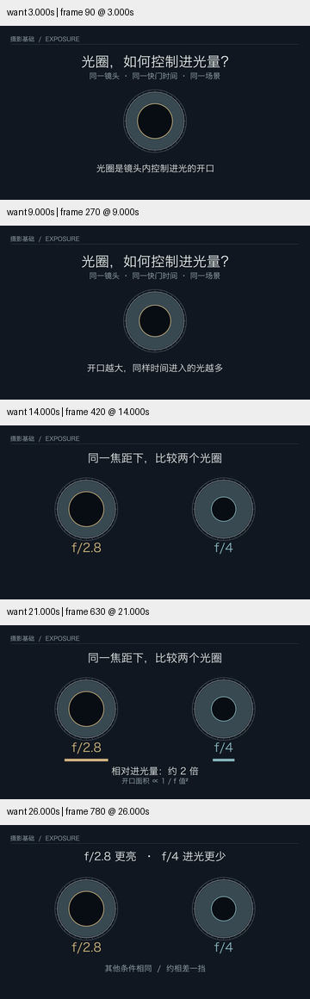
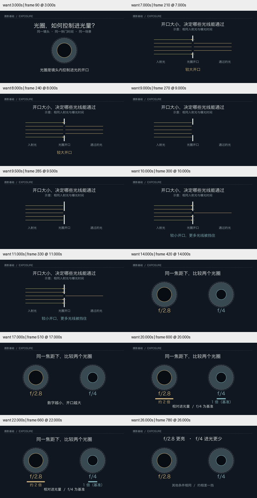

# 中文摄影题材 · 独立试用及反馈修订

使用 skill-creator 的独立试用方法，将以下请求交给未继承父代理历史的 Terra medium 执行者：制作 25–35 秒中文动画，向摄影新手解释光圈如何影响进光量，呈现器材说明书风格，直观看懂 f/2.8 与 f/4。它可读当前 Skill 和所需参考，只能写独立验证目录，不能读取既有评估成果。没有给出预期画面或答案。

## 首轮结果

首轮 27.5 秒、720p，深色背景和细刻度镜头形状形成统一风格，中文可读；它自行增加约 2:1 的进光量条形。父代理检查发现，两个黑色圆孔与字幕仍没有直接呈现开口阻挡光的关系，且比例基准不够明确。这不是一次全面通过的首轮测试。

## 有反馈的修订

父代理要求补足开口与光的可见因果、说明比较基准、检查 360px 尺寸，并保留首轮。修订自主选择侧视的平行光路示意：固定入射路径，小开口挡住更多路径。随后回到前视开口与相对进光量，明确 f/4 = 1、f/2.8 约 2。过渡先隐藏出射线，改变开口，再呈现结果，避免线缩短造成光倒流的视觉含义。

最终 26.8 秒、1280×720、30fps，解码 804 帧。父代理查看修订源码及开头、侧视状态、9–10 秒过渡、数值比较和结尾采样。源代码/视频哈希和帧报告见 [conditions.json](conditions.json)。初稿、首轮和修订视频都保留在 verification 目录。

## 准确性和剩余限制

同焦距、同曝光时间及其余条件相同；以圆形开口近似入口孔径。半径 .80/.56 对应直径比 4/2.8，面积比约 2.04，成片明确使用“约 2 倍”。侧视线条是路径示意，数量不是光子计数、面积采样或精确进光比，不应把 3 条/1 条用于解释 2 倍。

没有真实光学仿真、配音、受众理解实验或完整正常速度审美验收；次级说明在 360px 下仍偏小。该原型使用本机 Hiragino Sans GB 并在模块加载时设置背景 config，因此保存为评估证据，没有直接加入跨平台示例库。没有将“反馈后改进”写成“独立首轮泛化成功”。

播放功能补查：浏览器以 1× 从头播放修订版至结束，媒体错误为空、报告丢帧为 0。此项验证播放路径，不能替代连续观看的节奏或审美判断。

## 规范融合

`references/visual-direction.md` 增加机制解释检查：区分可见原因和后果，必要时用另一视图提供缺失证据；区分示意光线与定量比例；比例必须明确基准。目标继续 active。实际生成仍需更多题材、完整播放检查与美术迭代。
