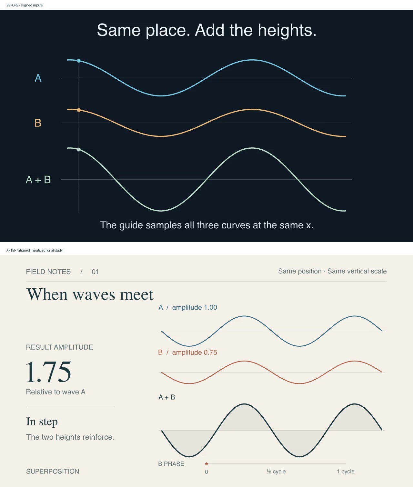
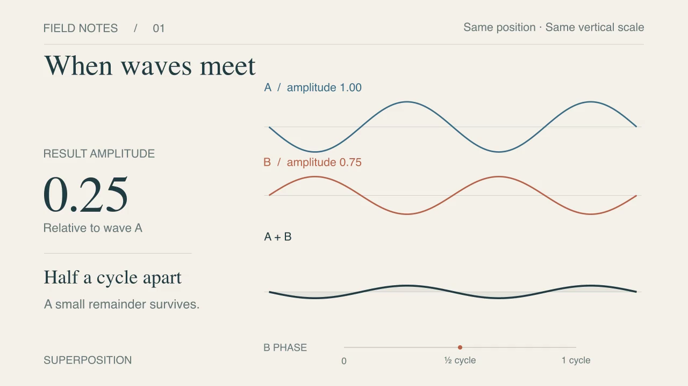

# 视觉精修：波形叠加

2026-10-29。延续上一轮 [30 项目调研](../../research/animation-craft-2026-10-29.md)。
目标是把“精致、美观”落实为可检查的画面选择，而非用渲染通过证明审美。

## 方向与变更

原版：深色、三轨曲线、同位置探针，强调逐点相加。
精修版：暖纸色、蓝/陶红输入、深墨色结果、左侧大号振幅、右侧等比例波形。
以编辑式科学插画为方向，统一左右对齐、标题/数字/注释层级和细辅助线；相位条提供状态锚点。
半周期错位后保留 0.25 的剩余振幅，同相恢复到 1.75。

原版和新版均为本项目原创，未复制第三方代码、字体或图片。
新版牺牲了逐点相加探针的讲解时间，转而突出相位和振幅关系，因此不是仅改变配色的受控对照。



## 设计参考的证据边界

此前已读取 Motion Canvas、Anime.js、JAnim 等项目源码/文档，具体来源见调研表。
本轮补看 [Motion Canvas 首页](https://motioncanvas.io/) 的实际页面：大标题、单个绿色强调、宽留白与较安静的演示区；这只支持布局观察，不代表观看了其完整动画作品。
[Motion Canvas tweening](https://motioncanvas.io/docs/tweening/) 和 [Anime.js timeline](https://animejs.com/documentation/timeline/) 支持缓动及编排的技术理解，不是审美效果的实验证据。
本轮的编辑式版式是原创设计选择，不冒称来自上述项目的现成模板。

## 实际修订与验证

首稿抽帧发现相位刻度与页脚说明拥挤。最终版将说明移至右上，给刻度独立空间。
检查最终版开场、曲线绘制中段、同相、相位变化中段、反相字幕出现邻域与结尾，共 11 个时间点；未见关键文本相撞或裁切。结果曲线、数字与相位一致。

- 最终视频：1280×720、30 fps、542 帧，约 18.065 秒，完整解码通过。
- 数值复核：17 个相位各采 100001 个横坐标，曲线峰值与解析振幅误差小于 1e-8。
- 原有 11 项单元测试通过；Skill 验证通过，`git diff --check` 通过。
- 画面使用系统 serif/sans-serif；跨平台字体外观尚未验证。

精确采样时刻、源文件和视频 SHA256、独立数值复核见 [conditions.json](conditions.json)。
浏览器 1× 播放至结束，媒体错误为空、报告丢帧为 0。这仅验证播放路径；静帧审查不能替代完整节奏及真实受众的审美验收。



## 复现与交付

```bash
uv run manim -qm examples/interference_study.py InterferenceStudy
```

本地对照播放器：`verification/art-direction-final/comparison.html`。
本地成片：`verification/art-direction-final/videos/interference_study/720p30/InterferenceStudy.mp4`。
融合回 Skill 的方法见 [aesthetic-refinement.md](../../../references/aesthetic-refinement.md)：
先确定美术方向，再审查主次、字体、间距、配色、表面细节与节奏，保留同状态对照。
