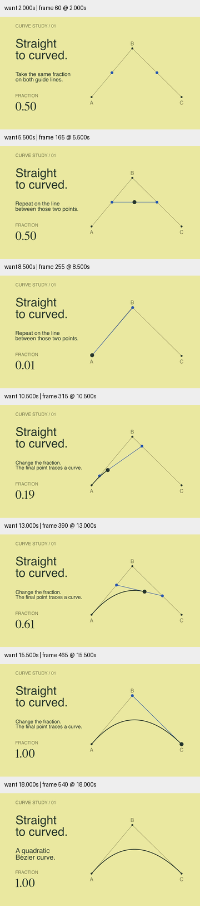

# 几何视觉方向 · 直线构造曲线

原创 `BezierConstruction` 将文字留在左侧、几何留在右侧：浅黄背景、深绿主轨迹、蓝色中间构造。无衬线标题和显式 serif 数值提供层级；不是将已有深色面板简单换色，而是围绕一个可持续追踪的构造安排版面。

## 来源

新增筛选 [Paper.js](https://github.com/paperjs/paper.js)、[Bézier.js](https://github.com/Pomax/bezierjs)、[SVG.js](https://github.com/svgdotjs/svg.js) README，累计 58 个成功筛选的不同仓库。后两者 README 标注 MIT；本轮未核实 Paper.js 许可证。深入阅读 Bézier.js `src/bezier.js` 的 hull、split、compute：反复对相邻点进行插值，拆分时复用这些中间点。记录与摘录见 [研究 JSON](../../research/bezier-craft-2026-10-29.json)。没有将上游 JS 移植进示例，也没有新增运行依赖。

## 视觉与解释

先固定参数 0.5 显示两条控制边上的中间点，再连接它们，并在新线段上取相同比例。之后将参数归零，连续推进到 1，最终点留下轨迹。控制点 B 始终可见，避免暗示曲线必须经过 B；曲线由插值构造，不通过将三角控制折线变形来伪装推导。

检查 2、5.5、8.5、10.5、13、15.5、18 秒，包括参数回退、轨迹生长中段和结尾。定向 smoke、Skill 验证、diff 检查通过。15 项测试通过，新增语义测试比较插值结果与独立 Bernstein 多项式表示，并检查两端点。数值字体在最终版显式指定，不依赖默认字体选择。

## 融合与边界

配方增加曲线构造、控制点角色及“参数变化不等于弧长速度”的区别；SKILL 和双语 README 已接入示例。当前 sweep 使用线性参数，因为讲解的是取点比例，不声称匀速沿路径运动。

成片和源码哈希、时长、帧数见 [conditions.json](conditions.json)。本轮检验抽样画面和数学对应，不包含完整正常速度美术验收或受众理解实验；浅黄方案是一个视觉方向，不作为所有题材的默认风格。目标继续 active。
