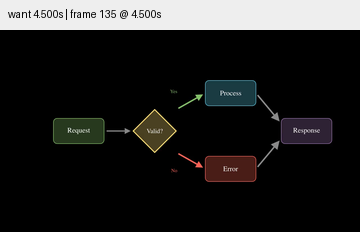
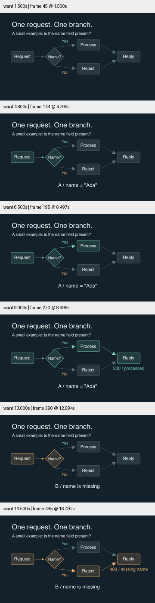

# 默认流程示例精修 · 条件执行

本轮直接改进已有 `examples/flowchart.py:BranchingFlow`。原版显示 Request、Valid?、Process/Error、Response 的节点和全部箭头，最终停留 1 秒；没有实际条件选择。Yes/No 为 14 号字，手机预览难读。

修订保留固定流程布局，用两条具体记录 `{name: "Ada"}` 与 `{}` 演示有名字/缺少名字。路由从记录的字段检查选择；未选路径保持中性，选中连接依次着色，节点在到达后响应，Reply 最后显示示例响应。第一条完成后明确清除高亮，再处理第二条。

标题、节点和分支标签放大，统一无衬线字体；不同结果有 Yes/No、记录文字和状态码辅助，不只靠颜色。菱形分支从实际顶部/底部连接，避免从其包围框的空角出发。辅助函数只增加可选字号参数，默认值保持原样；其余三个场景不重构。

## 证据与边界

- 保存原版源码和视频，按“完整拓扑”状态对照初始布局，而不是只挑终态。
- 检查修订 1.5、4.8、6.5、9、13、16.5 秒的 360px 画面；字体最后修订后重新渲染并复查。
- SimpleFlow、BranchingFlow、VerticalFlow、ProcessHighlight 四个 smoke 均通过；15 项现有单元测试、Skill 验证、diff 检查通过。单元测试没有假装验证画面审美。
- 改动同时增加了说明内容和片长，不能作为只隔离美术风格变量的实验。字段检查是教学例子，不是完整请求校验；200/400 为声明的示例行为。
- 没有完整正常速度审美评价或用户理解实验。结构、渲染和采样通过，不代表全部默认示例已经精修完成。

原版/修订的源码与媒体哈希、时长和检查记录见 [conditions.json](conditions.json)。`references/blog-patterns.md` 更新为实际的条件执行模式。此前研究形成的因果顺序、对象状态和交付宽度检查用于这个已有入口；本轮没有新增外部仓库数量。目标继续 active。
