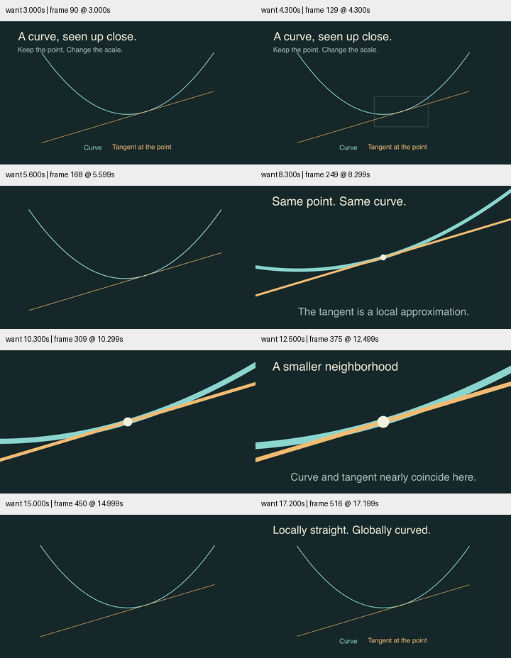

# 相机与局部解释 · 迭代检查点

本轮沿用当前工作树，目标继续 active。现有 CameraFocus 只展示圆形缩放，缺少“为什么要靠近”的解释任务，因此新增原创 `LocalLinearity`。

## 来源与实现

深入阅读 Motion Canvas Camera 的中心定位、缩放和 reset，以及 Manim CE moving-camera 场景示例；同时直接检查已安装 CE 0.22.0 的 auto_zoom 实现。文件链接及 blob SHA 见[来源记录](../../research/camera-craft-2026-10-29.json)。没有复制上游代码或引入另一个引擎。

场景使用同一条 y=0.15x²−1.2 曲线、x=1 的点与其切线。全景先给目标框；靠近后显示局部字幕，再靠近一次，最后 Restore 返回初始视野。点、曲线、切线均不改变世界坐标。字幕只在镜头停稳时出现，字号按当前 frame.width 与全景 frame.width 的比例计算，保持相近的视觉尺寸。

## 检查

- 1280×720、30 fps，最终完整解码 531 帧、约17.699秒。
- 检查 3、4.3、5.6、8.3、10.3、12.5、15、17.2 秒，包含目标框、缩放中段、两档字幕及回到全景。
- 局部画面有意裁去曲线远端；抽样中关键点和字幕保持在画面内。相机放大也放大了点和描边，这是同一几何的缩放，不宣称光学固定线宽。
- 新语义测试用多个切点检查切线接触与数值斜率，并验证距离减半时二次曲线的误差变为四分之一；13项测试通过。
- LocalLinearity 定向 smoke 通过；Skill 验证通过；diff whitespace检查通过。

首次取样请求18秒超过真实片长，被检查器拒绝；随后按实际17.699秒时长取样，未修改或截断视频来迁就检查。

文件/成片哈希见 [conditions.json](conditions.json)。这是数学关系与采样画面验证，不是受众理解实验、跨平台字体验收或完整正常速度审美评价。

## 融合

`references/advanced.md` 增加相机讲解配方和 auto_zoom 的实际边界；SKILL、双语 README 增加示例入口。下一轮继续检查镜头/文字的更复杂题材，而不把这支曲线样片当作泛化成功。

播放功能补查：本机浏览器以 1× 播放最终视频至结束，媒体错误为空、报告丢帧为 0。此项只验证播放路径，未替代上述审美与理解验证边界。
