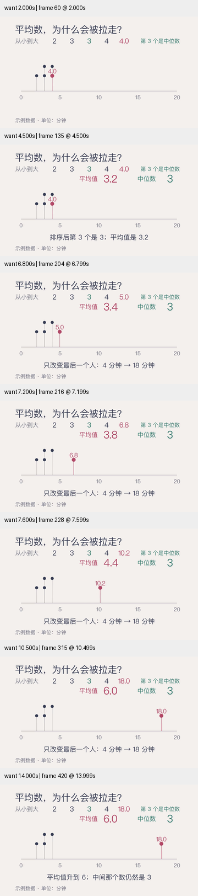

# 中文统计讲解 · 迭代检查点

原创 `MeanMedianStory` 使用五条合成等待时间 `[2,3,3,4,4]`，仅将最后一项连续改为 18。平均值由 3.2 变为 6，中位数始终为 3。目的在于检验中文排版、重复数据、动态读数与小屏信息层次，不宣称它已达到整体审美目标。

## 发现与修改

初稿使用一致的中文字体，但 DecimalNumber 使用了不同的数字字体；数据集中在坐标轴左侧，缺少“中间第三个数”的可见依据。修订后增加排序行，第三项着绿色，变化项着玫红色，数字也使用本机确认存在的 PingFang SC。由同一个 tracker 驱动位置、排序行和平均值；中位数由真实列表计算。

第二次 360px 检查发现，给移动值增加小数后会挤到旁边重复数据的标签。最终移除图中重复的静态数字，由排序行负责精确读数，坐标图保持固定 0–20 尺度以展示离群点的距离。点仍逐条保留，重复值上下错开。底部注明示例数据和分钟单位。

长中文句另作排版实验，确认 `Text(width=...)` 缩放而非换行，结果融入 `references/mobjects.md`。最终样片标题本身较短，不能把这一支成片称为长标题综合验证。

## 验证边界

- CE 0.22.0，1280×720，30 fps，完整解码 440 帧，约 14.665 秒。
- 查看 2、4.5、6.8、7.2、7.6、10.5、14 秒的 360px 预览，覆盖变化中段与终态；没有声称完成逐帧或正常速度审美验收。
- 检查五个 tracker 状态的均值与中位数。动态读数显示一位小数，汇总以未舍入值计算；中间显示值可能存在舍入差异，端点精确。
- 13 项现有单元测试和 Skill 结构验证通过。这些不等于中文理解实验。
- 依赖本机 CJK 字体，未验证 Linux/Windows 字体效果；因此保留为评估样片，不加入默认跨平台 smoke 清单。

源代码快照、成片哈希和采样报告见 [conditions.json](conditions.json)。初稿保留为 `draft-source.py`，最终为 `mean_median.py`。[来源筛选与取舍](../../research/chinese-statistics-2026-10-29.md)。目标继续 active；下一轮继续探索更有表现力的画面构图与场景衔接。
