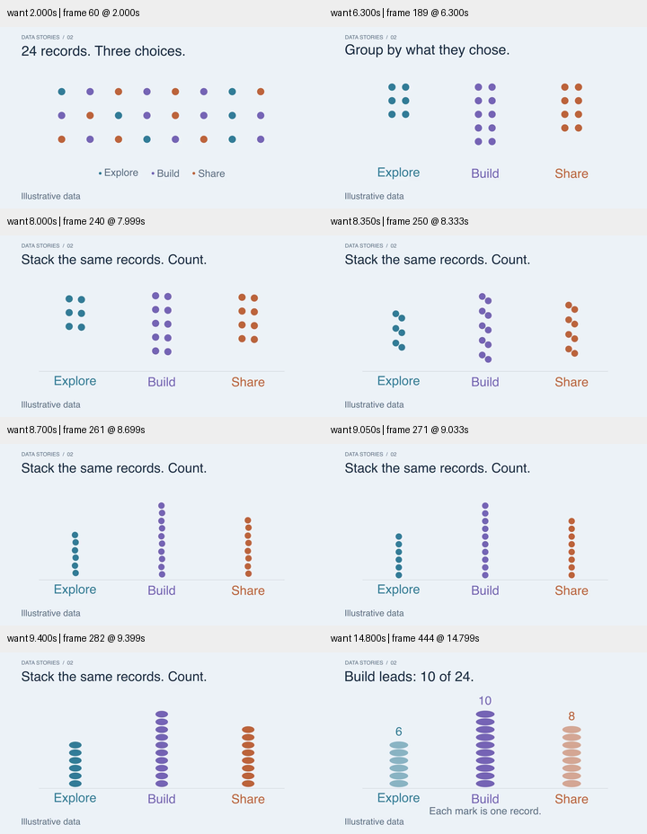
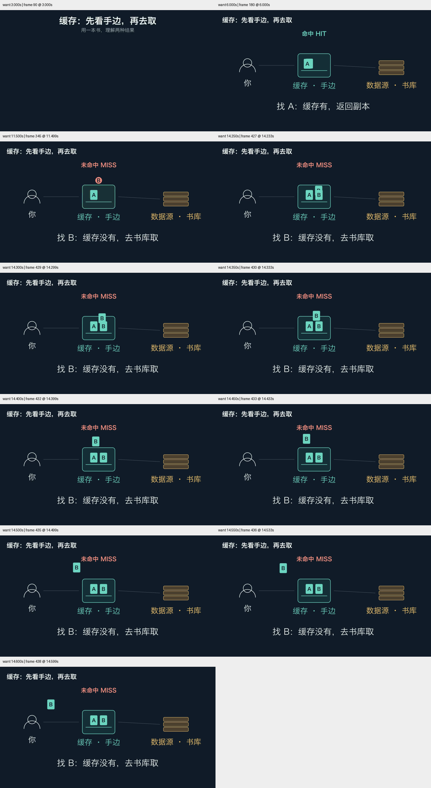
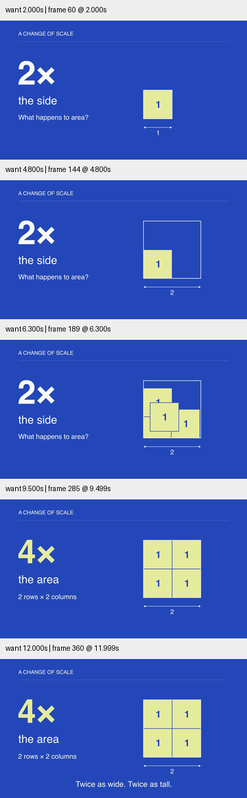

# 持续改进检查点 · 数据叙事与中文缓存

2026-10-29。整体 Goal 保持 active。本记录只描述这一轮已执行的工作；不表示动画生成质量已达到终点。

## 数据叙事：从记录到计数

新场景 `examples/data_to_decision.py` 使用 24 个合成分类记录。6 个 Explore、10 个 Build、8 个 Share 来自实际 Counter 计算。所有记录通过同一对象先分组、再排成单列，最后展开成等高标记；每个标记仍对应一条记录。

实际修订：

1. 360px 宽检查显示首版类别和脚注太小。增大类别、缩短脚注、增加计数柱高度。
2. 过渡抽帧发现圆点直接 Transform 为矩形会扭转，且顶部记录转到底部造成不必要交叉。保留上下顺序，改用同一路径结构的椭圆，并拆开“排成列”与“展开宽度”，减少同时变化。
3. 最终版 1280×720、30fps、452 帧，15.066 秒。最终 8 个样本包含重排中段、展开中段及结论。已完整解码；无真实受众测试。

## 独立中文缓存试用

新上下文代理得到当前 Skill、20–30秒中文缓存请求及隔离目录，没有父代理设计答案。模型为 gpt-6.1-terra / medium。首次成片 23.299 秒、699 帧，确实完成中文图形比喻，但不能算语义验收成功。

父审查发现首版命中时把缓存书移走，且随后直接进入未命中，容易误教为读取消耗缓存。后续反馈明确要求返回副本、保留 A，并用不同的 B 请求示范未命中。这些是反馈后的修订，不是盲测首轮结果。

后续实际检查还发现了三个位置问题：B 请求停点压到 A；B 返回直线扫过 A；抬高弧线后又碰到 MISS 标签。依次调整请求停点、返回通道和状态标签位置。最后检查 14.25–14.6 秒每 0.05 秒的采样，标签与 B 分离。移动副本从本体分离的初始重叠是复制动作，区别于穿过无关 A 的遮挡。

最终仍为 1280×720、23.299秒、699帧；使用本机 Hiragino Sans GB，不进入跨平台默认示例 smoke。两版源码保存为 `cache-first.py` / `cache-final.py`，中间所有修订及视频留在 verification/transfer-cache-20261029。示例假设源有 B，且采用未命中后填写缓存的策略。

## 工具与指导融合

- 增加 `video_inspection.py --preview-width`，保持横/竖画幅比例；取证源帧仍为原分辨率。
- 新测试用真实编码的横屏和竖屏视频验证预览尺寸、取样帧身份、原帧尺寸不变。当前 12 项测试通过。
- 数据场景定向 smoke 通过；Skill quick_validate 通过。
- 创作配方增加记录→汇总、比喻的复制/移动语义；美术指导增加显示尺寸检查。

文件及成片哈希、解码报告见 [conditions.json](conditions.json)。
静帧/中点检查不等于正常速度的完整审美验收；尚未进行真实设备、受众理解或旧 Skill 对照实验。

浏览器播放路径补查：数据最终版与缓存最终版均在本机浏览器以 1× 播放至结束，媒体错误为空、报告 dropped frames 为 0。此项为播放功能验证，未把它计为完整的人工节奏审查。

## 继续扩展：大字与几何

新增 `AreaScaleStory`，采用钴蓝背景与浅黄色单位方块。固定左下角，先把边长从 1 扩大到 2，再以四个相同单位正方形铺满轮廓，最后把大字重点从边长 2× 切到面积 4×。原稿最后一句 “Area scales twice” 容易被理解成面积只翻倍，已改成 “Twice as wide. Twice as tall.”，并保持放大后的外轮廓位于填充之上。

已检查 2、4.8、6.3、9.5、12 秒的 360px 预览，覆盖复制铺排中段与最终结论；定向 smoke 与完整解码通过。单位副本从同一原形出发的短暂叠放属于复制揭示，不把中间重叠区域当作可测面积。来源参考是 Coldtype 按词组织和 HyperFrames 实际媒体样本的尺度对比；作品与代码为本项目原创，未搬运素材或字体。

当前遗留方向：完整镜头节奏的人类观看评价；中文题材更多样本；相机聚焦与跨镜头连续性；跨平台字体。总体目标保持进行中。
