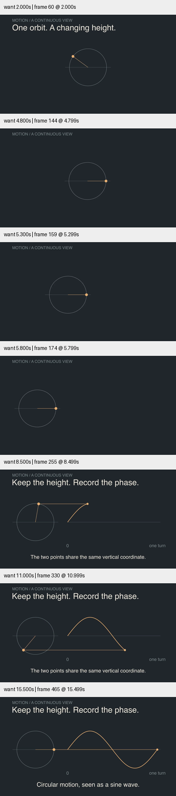

# 连续转场 · 圆周运动到正弦波

原创 `CircleToWave` 保留圆、辐条和同一个运动点：先完整转一圈，固定相位将整组几何移到左侧，再逐渐记录高度。第二阶段两个点共用相位，水平连线直接展示等高关系。转场并不把圆的轮廓变形成波形，因此没有暗示错误的几何对应。

本轮继续筛选 [Movis](https://github.com/rezoo/movis)、[Animation Nodes](https://github.com/JacquesLucke/animation_nodes)、[Automaton](https://github.com/baku89/automaton) 的 README，累计成功筛选 50 个不同仓库。Movis 与 Automaton 的 README 声明 MIT；Animation Nodes 此次未查许可证。筛选量不代表审美验收。没有引入依赖、复制源码或素材。

深入阅读 Movis 的 [custom_transition/render.py](https://github.com/rezoo/movis/blob/main/examples/basic/custom_transition/render.py)，文件 blob SHA 为 `fb2849941a5afde70a65e1c573017504e308c662`：它用错开的矩形 alpha 遮罩覆盖两幕交界，适合章节切换。这一机制没有直接移植；本题要求持续看见同一对象，采用连续构图交接。Movis 的组合图层和时间组织提供了比较依据，不宣称本场景来自其示例。工具来源与内容指纹见[研究记录](../../research/continuous-transition-2026-10-29.json)。最初 `/readme` 端点被工具拒绝，改为 `/contents/README.md` 后成功读取，不将失败请求计入筛选。

## 视觉修订

初稿的等高连线在 1280px 图像可见，但缩为 360px 时过弱；最终增加线宽和不透明度。初稿的轴标签靠近波形末段，最终移到曲线完整运动范围下方。标题先退出，几何移位后才显示新标题，避免两段文字叠加。

最终 1280×720 / 30 fps，完整解码 501 帧，约 16.699 秒。检查 2、4.8、5.3、5.8、8.5、11、15.5 秒，包括转场中段。定向 smoke、Skill 验证、diff whitespace 检查通过。所有轨迹按当前相位重新计算，不依赖前一帧累积；未进行受众理解测试或完整正常速度审美验收。

已融合进动画配方、SKILL 路由与双语 README。源快照和成片/测试记录见 [conditions.json](conditions.json)。目标保持 active；后续仍需检验长叙事、多种风格与实际生成任务，不能把这一支简单几何样片当作整体完成。
