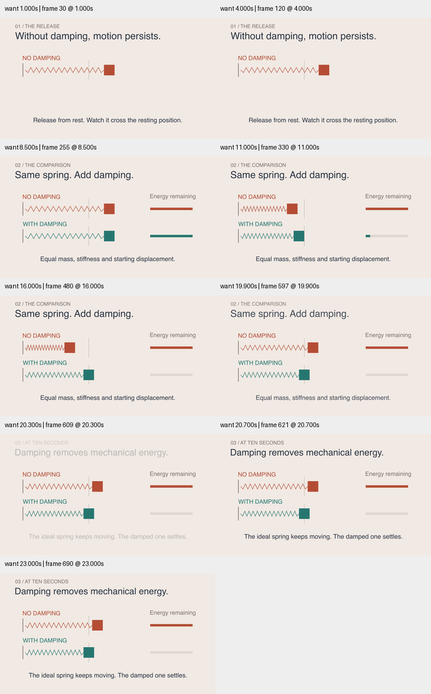

# 三段物理讲解 · 阻尼与能量

原创 `DampingStory` 分为释放、控制条件对比、十秒快照三段。暖纸底、深色标题、珊瑚色无阻尼组和青绿色阻尼组保持一致；线圈、平衡位置、方块和能量条使用固定尺度。不是一个通用弹跳特效。

第一段展示理想弹簧从静止释放。第二段明确重新开始，两组质量、刚度、初始位移相同，只改变阻尼；物理时间以 linear 推进。第三段标明“AT TEN SECONDS”，停止时间用于解释，避免把静止结尾误认为理想弹簧自行停下。条形显示归一化机械能，不是位移大小。

## 来源与取舍

本轮读取 [react-spring README](https://github.com/pmndrs/react-spring) 和 [JNWSpringAnimation README](https://github.com/jwilling/JNWSpringAnimation)，累计成功筛选 52 个不同仓库。react-spring 此次只核实 README 所述的弹簧优先和跨渲染目标组织，不声称验证它的效果、性能或许可证。

深入阅读 [JNWSpringAnimation.m](https://github.com/jwilling/JNWSpringAnimation/blob/master/JNWSpringAnimation.m)，blob `2ac6c2ea9294d9a6ef2aa1c87565e8918a318a7b`，源头含 MIT 文本。其指数衰减余弦和阈值结束机制用于 UI 动画；正阻尼时的零相位简化式不对应本题要求的零初速度。没有复制代码，而是使用欠阻尼解析解及其导数，明确本样例的阻尼域和初始条件。没有引入依赖。来源与内容指纹见[研究记录](../../research/damping-story-2026-10-29.json)。

## 修订与验证

初稿能量标题在小屏偏小，最终改为更短、更大的“Energy remaining”。开场标题也改成画面直接支持的“Without damping, motion persists”，不暗示已经可见地拆解了动能和势能交换。

检查九个时刻，覆盖两组运动、能量下降和章节文字切换；转场采样中的低透明文字是淡入阶段，并无两段字幕叠加。完整解码、定向 smoke、Skill 验证、diff 检查通过。14 项单元测试通过，其中新增测试核验初始位移与零速度、运动方程、无阻尼能量守恒、阻尼能量损失率和单调性。

成片与源码哈希、尺寸、帧数、时长和采样时间见 [conditions.json](conditions.json)。这是具体模型和抽样画面的验证，不是逐帧美术验收、完整正常速度节奏评价或受众理解实验。仍需更多实际生成与风格比较。

多段讲解的“问题—证据—固定条件—结论”约束已融合进美术精修参考，示例加入 Skill 路由和双语 README。目标继续 active。
