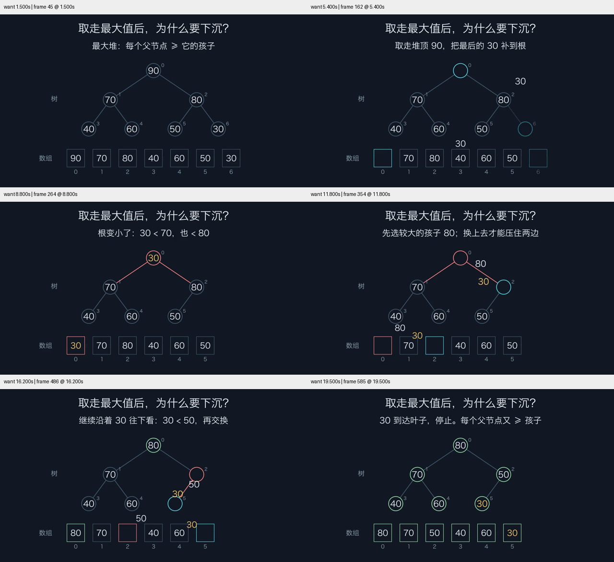

# 新会话试用：取走最大堆堆顶后为何下沉

2026-10-26。一次当前 skill 的独立试用；不是与旧版的 A/B 对比，也不是普遍审美、学习效果或首次成功率测试。

## 任务与条件

任务原文：**用 Manim 生成一个 15–25 秒中文动画，解释最大堆取走堆顶后为什么需要下沉调整。让树和数组对应起来，重点是看懂这个局部操作。交付 MP4 与 Python 源码。**

新代理未继承父会话，仅收到任务、当前 skill 路径、现成 Python 环境和隔离输出目录；没有收到预期设计、数组或答案。配置为 gpt-6.1-sol / medium（工具请求配置，不是独立服务端模型身份查询）。
在查看产出前，父代理记录了[判据](criteria.json)。[条件与哈希](conditions.json)记录 skill、视觉指导、依赖锁文件、源码及媒体身份；渲染环境为 macOS、Python 3.13.14、ManimCE 0.22.0、Cairo。

## 观察结果

| 判据 | 证据 | 结论与范围 |
|---|---|---|
| 交付 | 1280×720、30 fps、20.10 秒、603 帧完整解码；源码与最终 MP4 存在 | pass：符合这一次任务的格式和时长 |
| 算法 | 初始 `[90,70,80,40,60,50,30]`；独立计算得到补根、交换 `(0,2)`、交换 `(2,5)`；末态 `[80,70,50,40,60,30]` | pass：本例值保持、较大孩子选择和末态堆性质正确 |
| 树/数组对应 | 1.5、5.4、8.8、11.8、16.2、19.5 秒的实际视频帧；索引和值相对应，补根后在两种表示中用黄色追踪 30 | pass：所采样的静止/运动中段一致；不是每一帧的自动语义证明 |
| 为什么下沉 | 8.8 秒根 30 与两个孩子的边被强调；11.8 秒选 80；16.2 秒继续与 50 交换；结尾回到父≥子 | pass：关系违例与修复由图形和文字共同体现，不仅有结论文字 |
| 布局 | 六个指定时刻的原视频采样，含补根与两次交换中段 | pass（采样范围）：中文与关键数值可读，未见关键文字遮挡/裁切；有意的节点包含、边相交不当作失败 |
| 时间连续性/节奏 | 未进行原速播放；只做静帧与运动中段检查 | not_checked：不声称整片运动自然或停留时长合适 |
| 学习效果/普遍改进 | 无真实受众理解测试、无旧版对照、无多任务样本 | not_measured |



截图来自同一已生成 MP4，使用仓库的 `video_inspection.py` 顺序解码采样；图头显示请求时间、实际呈现时间与索引。输入视频 SHA-256 见 conditions.json。图像与源码提交在此目录；视频及原始代理回执保留在本地交付目录，不作为仓库默认依赖或 CI 产物。

## 修订证据的限制

代理回执自述：低清自查发现填充高亮影响对比度、补根路径经过数组文字，随后改为描边高亮与分开的弧线路径。父代理复查的是最终版本；初版源码/媒体未单独提供，因此这两项是作者自述，不能当作父代理验证过的前后对比，也不能计算首次成功率。总渲染耗时未完整记录。

当前脚本是固定七元素的教学快照，按本例手写两个交换，末态有断言；独立参考计算已核对这条路径。它不是可处理任意输入的堆实现，也不是未来生成场景的默认模板。

## 在已具备字体的环境中重渲染

快照源码使用 macOS 上已安装的 `Hiragino Sans GB`；字体未随仓库分发。其他平台需先选择实际存在且覆盖中文的字体并重新检查字形。这份历史样本不加入默认跨平台示例扫描，避免为一个评估快照增加平台字体依赖。

从仓库根目录运行（使用已有 Manim 环境）：

```bash
uv run python -m manim render -qm --renderer cairo --format mp4 --media_dir verification/fresh-trial docs/evaluations/heap-repair-20261026/heap_sink.py HeapSink
uv run python scripts/video_inspection.py verification/fresh-trial/videos/heap_sink/720p30/HeapSink.mp4 --at 1.5 --at 5.4 --at 8.8 --at 11.8 --at 16.2 --at 19.5 --columns 2 --output verification/fresh-trial-review
```

不同字体/平台的重渲染不保证字节哈希相同；本记录的哈希用于标识这次被检查的版本。

## 对 skill 的决定

这次试用在既有流程下完成了限定任务，并实际使用低清预览和指定时刻检查。保留当前按需指导和工具；没有证据需要再增加强制多代理、通用视觉总分或训练/评估运行时。独立试用记录补充了手写示例的证据，但没有证明 skill 相比旧版普遍更好。
