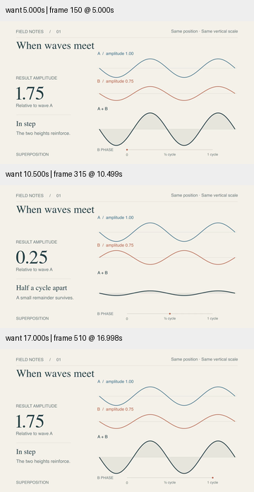
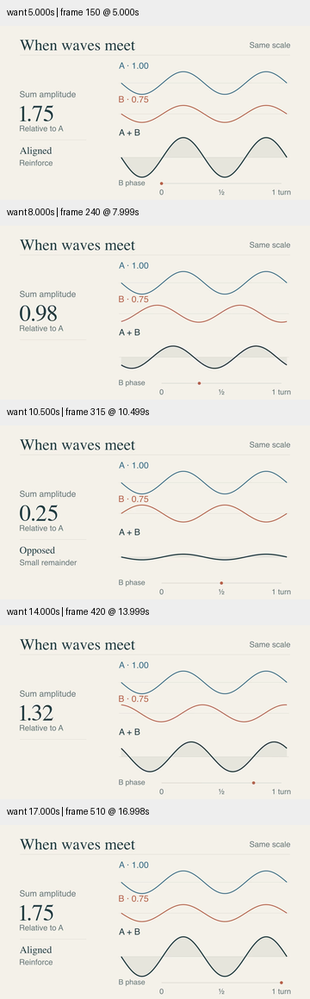

# 早期精修样片复查 · 手机宽度排版

本轮回查已有 `InterferenceStudy`。早期版使用 14–19 号字作为输入振幅、相位刻度和辅助说明，在 360px 的成片中明显太小；不能因为它曾通过大图检查，就沿用“精修完成”的判断。

修订去掉装饰性 FIELD NOTES 页眉和 SUPERPOSITION 页脚，将短标题放大，输入标签改成更短的 A/B 数值，增大相位标签与刻度。波形线略加粗，数值字体显式指定 serif。说明缩短为 Aligned/Reinforce 与 Opposed/Small remainder；大数值明确标为 Sum amplitude / Relative to A，保留量的含义。

## 可比性与验证

保留原源码。AST 对照确认 baselines、xs、screen_x、scale 以及 play 的 run_time / wait 参数未改变；输入仍为振幅 1.00 和 0.75，轨迹仍为 0→半周期→整周期。相位轨道在版面上的长度改变，代表的相位范围不变。数据尺度和时间保持一致，本轮比较的是文字层级、措辞和线宽。

父代理检查原版 5、10.5、17 秒和修订版 5、8、10.5、14、17 秒的 360px 预览，最后的 Sum amplitude 文案修改后重新渲染并复查。定向 smoke、Skill 验证与 diff 检查通过。哈希、原/新视频报告与不变量记录见 [conditions.json](conditions.json)。

修订是具体可读性改进，没有进行受众视力/理解实验或完整正常速度审美验收；仍不能把自动解码成功当作高级感评分。早期评估记录保留，当前 gallery 指向修订版。小屏复查和保留量名的经验已融入 `references/aesthetic-refinement.md`。本轮没有新增仓库计数，目标继续 active。
