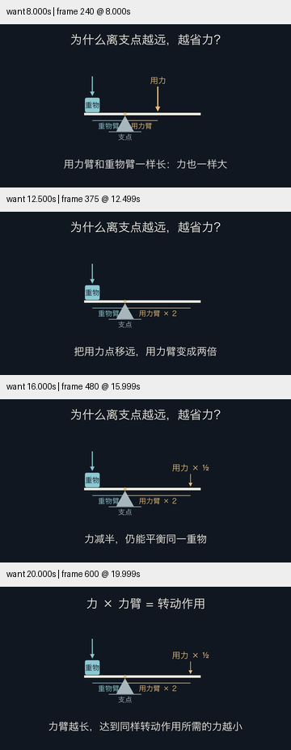
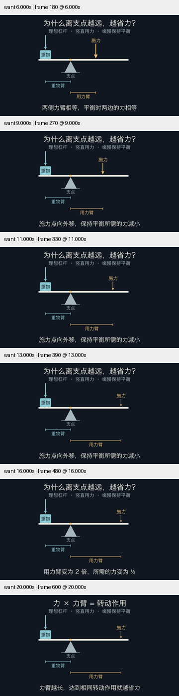

# 新题材迁移试验：中文杠杆

按 skill-creator 的独立前向测试方法，给新代理完整 Skill 和一个真实请求：制作 20–30 秒的精致简洁中文动画，通过动作解释离支点更远为何更省力，交付源码和 720p MP4。代理未继承父会话的研究结论，输出仅写入忽略的 verification 子目录。父代理在查看产物前保存了[检查条件](criteria.json)。

## 独立首轮

代理读取 SKILL.md、视觉导演、视觉精修和动画配方，自己渲染初稿并做一次自修订。其独立交付为 20.9 秒、627 帧；此前初稿也保留。父代理随后检查源文件和 360px 预览，发现：

- 装置偏小，力臂标签与支架区域拥挤。
- 文案称相等力，但重物力箭头长度约 .97 场景单位，施力箭头约 1.23，量的编码不一致。
- 移远时施力箭头消失，只剩尺寸线变长，缺少可跟踪的施力位置及力变化。

## 父代理反馈后

修订扩大装置，尺寸标注使用支架下方的独立通道。模型取重物力 W=1、重物臂 a=2、施力臂 r 从 2 到 4，施力 F=W×a/r。箭头使用同一长度尺度，位置、尺寸线和力大小由同一 r 同步驱动；画面明确为理想杠杆、竖直施力、缓慢保持平衡。

修订成片 20.7 秒、1280×720、30 fps、621 帧。父代理查看修订源码和 6、9、11、13、16、20 秒的 360px 预览：施力点外移时箭头缩短，标注不再与支架挤在一起。两版视频均完整解码，哈希见[条件](conditions.json)。

这是静态平衡的连续参数示意，不是失衡后的动力学仿真。没有完整正常速度播放验收，次要条件和尺寸文字在小屏仍偏小，也没有用户审美反馈。不能把父代理反馈后的改善记为独立首轮成功，或由单次试验推断普遍生成成功率。

此次只在视觉精修参考中补充了观测到的窄问题：力箭头共用尺度、参数与标注来自同一模型、标注避开支架。没有添加物理引擎。此试作依赖本机中文字体，保留为评估夹具，未加入默认示例集。

[首轮源码](first-pass.py)、[首轮自修订前源码](first-draft.py)、[反馈后源码](revision.py)、[首轮记录](first-pass-notes.md)、[修订记录](revision-notes.md)。相关独立物理项目调研见[来源与取舍](../../research/mechanics-craft-2026-10-30.md)。

后续父代理继续放大主体、标签并缩短字幕，见[小屏精修](../lever-phone-20261030/review.md)。此处仍保留当时结果，不覆盖其局限记录。
