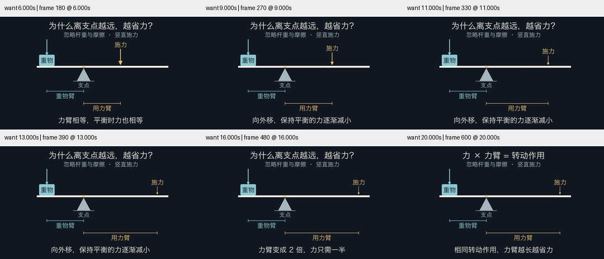

# 杠杆试作的小屏精修

延续[独立试作与反馈修订](../lever-forward-20261030/review.md)留下的小屏问题，本轮由父代理继续修改，不能计作独立首轮结果。

- 横向几何用统一的显示比例放大 30%，重物与施力位置、尺寸线仍对应同一组模型坐标。
- 支点、重物、施力、力臂等标签增大至 30–32 号；重物框同步扩大，避免大字挤入原来的小框。
- 条件明确为“忽略杆重与摩擦 · 竖直施力”。关键字幕缩短，并保持“平衡”的限定。
- 几何放大只改变显示映射，W=1、a=2、r 从 2 到 4、F=2/r 没变。力箭头长度表达式和所有 play/wait 时序经 AST 对照一致。

视频仍为 20.7 秒、1280×720、30 fps、621 帧，完整解码通过。在 360px 预览检查 6、9、11、13、16、20 秒；所检查帧内标签与支架、尺寸线分开，较上一版主体更大。未做完整正常速度审美验收或受众理解试验，不声明小字已适合所有设备或用户。

[源码](lever.py)、[上一版源码](before.py)、[条件与哈希](conditions.json)。保留本机中文字体要求，仍为评估夹具，不加入默认跨平台 smoke。
