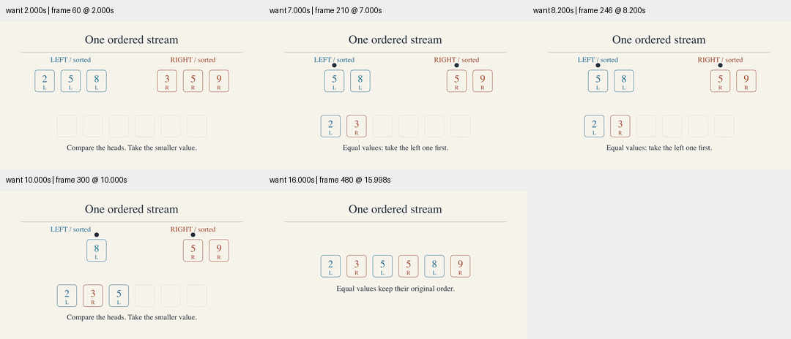
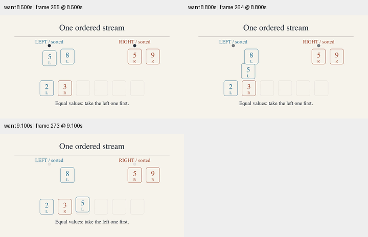

# 合并排序：让稳定性在画面中可见

旧示例的数值全不相同，无法展示稳定合并的相等分支。新版输入为左侧 2、5、8，右侧 3、5、9，约定原始序列中左段在右段之前。

- 每张卡片保留来源颜色及 L/R 标记，移动整张卡片。
- 相等时明确显示取左规则，停留 1.4 秒后移动左侧 5。
- 移除装饰性小字，放大来源标签及当前头部标记；相同决策字幕保持静止。
- 最终两个 5 保持 L、R 顺序。空序列阶段改为剩余元素说明。

最终视频为 1280×720、30 fps、501 帧，约 16.70 秒。检查了 360 像素宽的关键状态及移动中间帧，所抽取位置未见文字裁切或卡片重叠。15 项既有语义与视频检查测试通过，包括重复值稳定性测试；它们不能证明审美或教学效果。尚未完成完整正常速度审美验收。

[条件与哈希](conditions.json)、[最终源码](merge_step.py)、[修改前源码](baseline.py)。没有新增第三方依赖，也没有把这一示例的改善视为整体目标完成。
