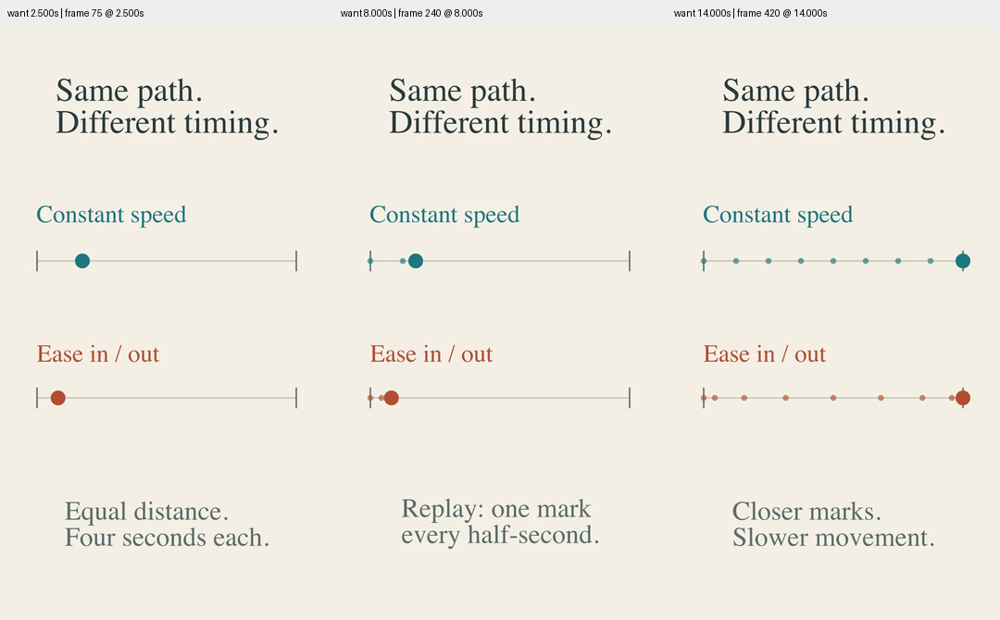

# 节奏对照的竖屏构图

`MotionTiming` 新增 9:16 构图：相机构造前设置匹配的场景宽度，轨道根据可用宽度确定；标题与字幕按语义分成两行。保留上下两条轨道的比较关系，减小移动点及采样点半径，避免短轨道上的端点采样挤成一团。没有把整个横屏画面等比缩小，也没有引入通用布局框架。

实际渲染 720×1280、30 fps、14.5 秒、435 帧，检查 2.5、8、14 秒。所有标签与轨道均在采样帧内，接近端点的标记可以区分。共享时间进度、缓动函数和播放时长保持一致；这里的距离是画面内归一化路径，不比较两种画幅的物理速度。

另重渲染 1280×720 横屏，435 帧全部解码后的像素 SHA-256 与修改前一致，见[对照](landscape-comparison.json)。16 项测试通过，相机宽高比和全局配置隔离检查同时覆盖 PacketJourney 与 MotionTiming。Skill 校验、diff 检查通过。

本轮没有完整正常速度审美验收，不声称任意长宽比、字体或跨平台显示均已验证。[源码](motion_timing.py)、[条件与哈希](conditions.json)、[前一轮横屏说明](../motion-timing-20261030/review.md)。
