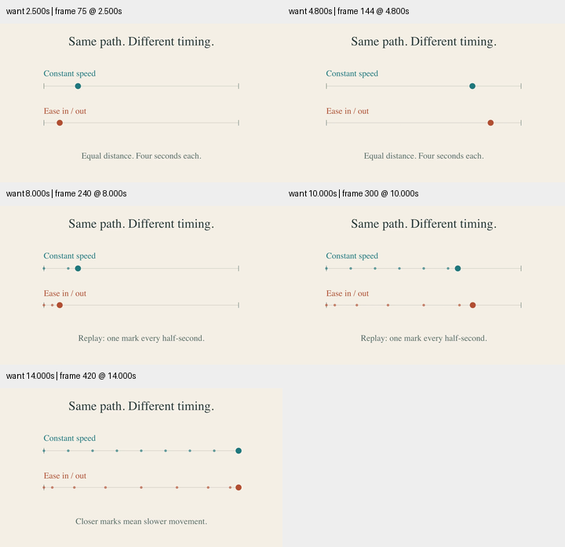

# 时间节奏：用等时间标记看见缓动

原创 `MotionTiming` 比较同一段距离、同四秒时长的两种位置映射。上方匀速，下方三次 Hermite 缓入缓出。共享 ValueTracker 线性推进，缓动只作用一次。第二遍播放前显式隐藏、复位，再每半秒留下位置标记。结束时稠密的端点标记对应较低速度，中央较疏对应较高速度。

浅纸底、青色与赭色区分两行；相同的轨道、标题层级和起止位置保持比较条件。没有用弹跳或超调制造虚假的位置范围，没有把这一缓动直接套到物理模拟。

成片 14.5 秒，1280×720、30 fps、435 帧。检查 2.5、4.8、8、10、14 秒的 360 像素预览。定向 smoke 渲染与解码通过；数值检查覆盖范围、单调性、对称性、近似零端点速度与等时间采样间距。Skill 校验、diff 检查通过。本场景在此前 28 场景完整回归之后加入，此次验证是定向检查，未声称重新跑过全套。没有完成完整正常速度审美验收，也没有测量观众理解效果。

[研究与许可范围](../../research/timing-craft-2026-10-30.md)、[源码](motion_timing.py)、[条件与哈希](conditions.json)。
