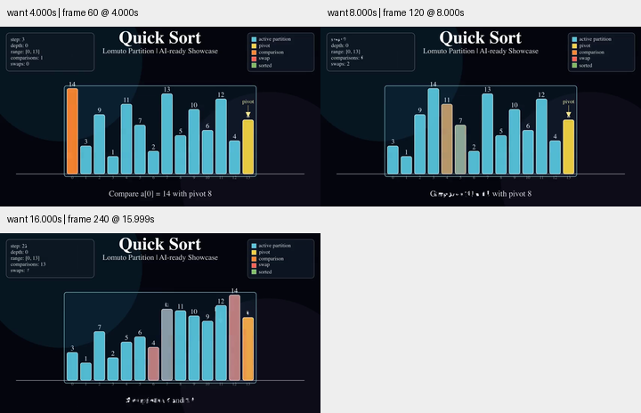
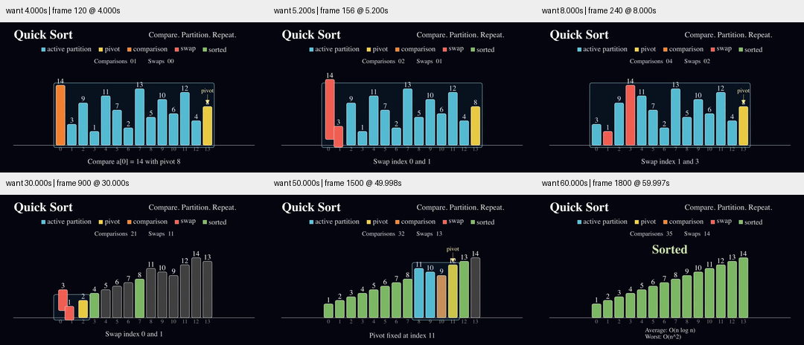

# 快速排序：真实换位与清晰的决策文字

旧示例在交换事件中把每个槽位的柱高和数字变形成新快照，观众可能把它看作数值改变。新版移动已有柱子和数字，再更新它们在位置列表中的引用。两个路径略微上下错开；颜色依旧表示当前算法角色，不表示不变身份。

画面去掉两个大面积背景圆和角落 HUD，改成顶部横向图例、比较/交换计数和独立标题。数字与图例放大。决策句直接切换，避免不同文字逐字变形时的碎字；交换开始前显示动作并暂时撤掉枢轴指针，交换后恢复；完成时撤掉活动区间框。

## 修改前

## 修改后

固定输入仍为 14、3、9、1、11、7、2、13、5、10、6、12、4、8。前后 build_events 的 AST 一致，保留末尾枢轴的 Lomuto 算法。新增检查在交换动画的多个插值位置验证柱高和数字保持不变，并在结束后验证原对象换位。16 项测试通过；完成状态的区间框隐藏检查、Skill 校验与 diff 检查通过。

视频全部解码，人工检查 4、5.2、8、30、50、60 秒的 360 像素宽预览，包括第一处交换途中与结束画面。这不是完整正常速度审美验收。柱子交叉时仍存在短暂遮挡，索引在小屏上仍偏小；本轮没有声称解决全部理解和可读性问题。数值标签与柱高在交换中保持一致，柱高包含最小可见高度，不适合拿其高度直接比较数值倍数。

[来源研究](../../research/sorting-craft-2026-10-30.md)、[渲染条件](conditions.json)、[最终源码](quicksort.py)、[原始源码](baseline.py)。仅作本地验证，未发布或合并。
