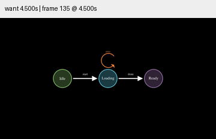
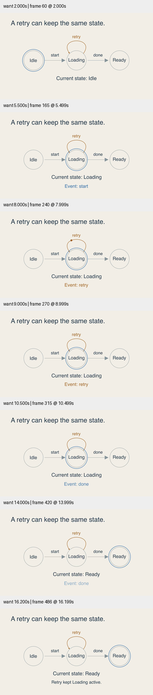

# 默认状态示例 · 可见的事件与当前状态

本轮直接改进 `examples/state_diagram.py:StateWithLabels`。原版仅建立 Idle、Loading、Ready 和文字标签；retry 是悬在 Loading 上方的独立弧线，没有演示当前状态。原版事件文字为 12–14 号字。

修订采用浅纸背景与深色文字，放大节点和事件标签。start、retry、done 依次触发；事件标记沿路径移动，独立的蓝色环和文字表示当前状态。retry 的连接两端都落在 Loading 边界，其运行期间当前状态保持 Loading；start/done 完成后才更新当前状态。最终一句使用过去时说明刚才发生的 retry，不把最终 Ready 错写成 Loading。

## 验证与修复记录

- 首次渲染发现 CubicBezier 不支持 add_tip，查本机 CE 0.22 源码后改为保留原曲线路径、独立绘制尖端；运动采样不包含尖端子对象。
- 第一次采样请求 16.5 秒超过实际约 16.499 秒片长，被检查器拒绝，改为 16.2 秒；没有修改视频来迁就采样。
- 检查 2、5.5、8、9、10.5、14、16.2 秒；重点观察 retry 期间状态环、事件标记与标签。最后文案修订后重渲染，重新抽帧并查看末帧。
- SimpleStates、StateWithLabels、LinkedListMismatch、CyclicStates 四个 smoke 通过；15 项现有单元测试、Skill 验证、diff 检查通过。

源码快照、视频哈希、帧数及命令记录见 [conditions.json](conditions.json)。此处是明确指定的示例状态机，不声称所有系统的 retry 都保持状态，也不验证真实网络请求。尚未完成完整正常速度审美验收或受众理解试验。

`references/blog-patterns.md` 已同步：事件标记与状态指示分开、回环明确连接、到达后改变状态。本轮将已研究的路径连续性和视觉验证原则用于现有入口，不增加外部仓库计数。目标继续 active。
