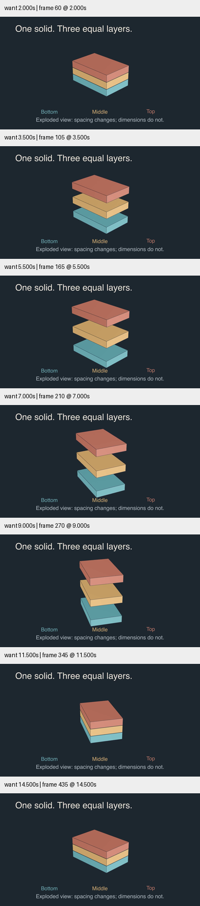
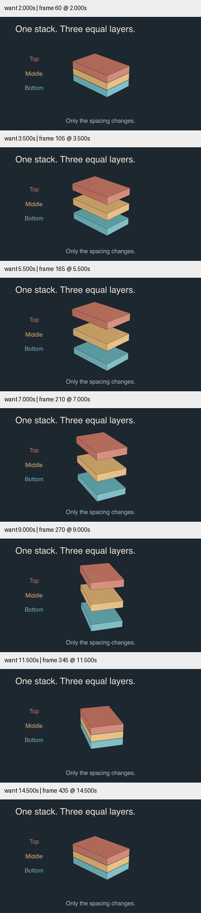

# 三维分解视图 · 投影范围与固定文字

新增原创 `ExplodedLayers`，保留原有 `Orbit3D` 作为最小 API 示例。三个 3.4×2.2×0.5 的不透明 Prism 用 .02 的初始间隙形成堆叠；分解只平移上下层，不改变尺寸。展开后镜头从 -45° 转至 -15°，重新组装后回到原视角。图例和文字固定在屏幕空间。

## 来源与选择

本轮筛选 [Pygfx](https://github.com/pygfx/pygfx)、[VisPy](https://github.com/vispy/vispy)、[Vedo](https://github.com/marcomusy/vedo) 的 README，累计 61 个不同仓库。VisPy 的 README.md 返回 404，目录列举确认 README.rst 后成功读取。Vedo README 声明 MIT，另外两者本轮未核实许可证；没有安装引擎或移植实现。

深入阅读 Pygfx [transparency2.py](https://github.com/pygfx/pygfx/blob/main/examples/feature_demo/transparency2.py)：相交且同位置的平面不能靠简单排序解决透明混合。它还把文字放在独立屏幕坐标场景中。这里采用该关注点，在 Manim Cairo 中使用不透明分层和固定文字；没有假定 Pygfx 的混合模式可直接用于 Cairo。README 中的性能和版本状态陈述未被当作本轮实测结论。[来源记录](../../research/three-d-craft-2026-10-29.json)。

## 真实修订

初稿把图例放在底部，镜头转向 -15° 后底层投影压到图例。最终将三项图例移到左侧，底部说明缩短并放大，保留物体的显示尺寸。标题改成 stack 而非 solid，准确反映有薄间隙的层状结构。

检查 2、3.5、5.5、7、9、11.5、14.5 秒，覆盖展开中段、镜头中段、最大旋转视角与复位。定向 smoke、Skill 验证、diff 检查通过。媒体哈希、时长、帧数和源码哈希见 [conditions.json](conditions.json)。这是 Cairo 渲染与采样验证，不代表 OpenGL、透明物体排序或完整正常速度审美验收。

三维解释的组装/分解/复位、按镜头检查投影范围及透明度选择已融入 `references/advanced.md`，并接入 Skill 和双语 README。该示例只讲层次与形状保持，不冒充实体机械装配或体积积分证明。目标继续 active。
