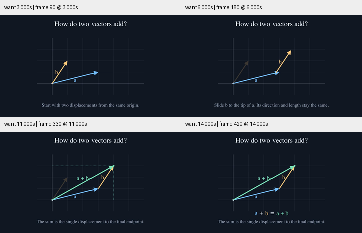
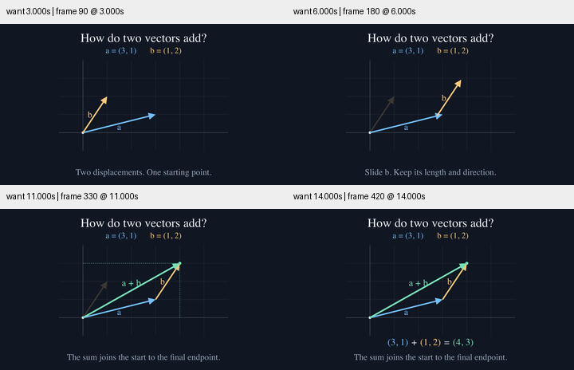

# 向量相加：结尾需要给出新信息

保留原有的同起点、平移 b、出现合向量三段连续动作。原结尾 `a + b = a + b` 只重复了符号，新版在开场明确 `a = (3, 1)`、`b = (1, 2)`，结尾用相同颜色得到 `(3, 1) + (1, 2) = (4, 3)`。

标题和字幕字号增大，字幕缩短；公式下移，与网格和底部说明分开。数字直接淡入，不把字母形状变形成坐标。端点、投影线和文字统一由输入坐标计算，避免相互漂移。未新增依赖，也未改变相加关系。

最终视频约 14.93 秒，1280×720、30 fps、448 帧。检查 3、6、11、14 秒的 360 像素宽预览；最终坐标重构版本的全部解码像素与已检查版本相同。渲染中的首尾连接断言通过，Skill 校验和 diff 检查通过。此轮是排版、文案和结果表达的改进，没有新增镜头机制，不作为跨题材生成质量的证明，也尚未完成完整正常速度审美验收。

[源码](visual_story.py)、[修改前源码](baseline.py)、[条件与哈希](conditions.json)。
